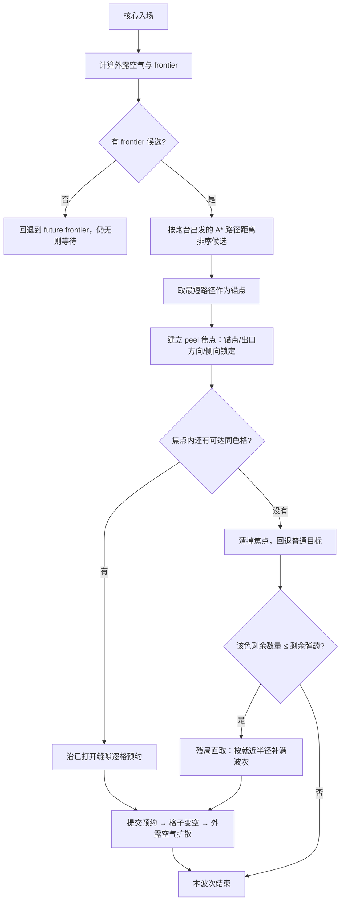

# 消除与选点核心

本文件描述 `core/original-board-state.js` + `core/board-session.js` 的实际行为，
两者由 `games/taxi-pick`（原包 LayaAir 迁移工程）逐行移植而来。算法本身不做改写，
只把原包的 3D 世界坐标换成“1 格 = 1 单位”的扁平坐标系。

## 目标

一颗核心入场后，要在**当前真正可达**的同色方块里挑出下一发，并在挑中之后
沿同色连通关系把这一片逐格剥离；既要保证画面是逐格波纹，也不能让方块穿过
仍存在的阻挡层直接起飞。

## 术语

- **外露空气**：从棋盘外部（第 3 关起仅下方与连续 2 格以上的边界缺口）出发，
  沿上下左右穿过空格能到达的格子集合。
- **可达方块**：四邻里存在外露空气的存活方块。
- **frontier**：当前所有可达方块的集合，按颜色分桶。
- **炮台开火点**：核心所在阵地对应的棋盘列，位于棋盘下方。
- **peel 焦点**：首发生效时确定的连通组锚点，包含锚点、出口方向、侧向锁定范围。
- **预约**：把某个格子从 `state=1`（存活）改成 `state=2`（已预约），
  从 frontier 中摘掉，但仍在棋盘上占位。
- **提交**：把预约格子改成 `state=3`（已清空），写入空格并刷新外露空气。

## 执行流程

## 详细规则

1. 外露空气

   棋盘围墙关闭时（第 1、2 关），四条边都作为空气种子；围墙打开时（第 3 关起）
   只从棋盘下方播种，外加边界上连续 `minOpeningCells`（默认 2）格以上的缺口。
   空气只穿过空格，因此任何被包住的内部格都不会被判定为可达。

2. 选点

   候选来自 frontier（没有则用 future frontier：已被预约、马上会腾空的格子）。
   每个候选都用 A* 从炮台开火点搜到该格，路径不能穿过存活方块，
   按世界路径长度打分；分数相同时退回“横向跨半场惩罚”与行列顺序。

3. peel 焦点

   锚点确定后，动作方式与原包的“剥开”一致：从锚点出发，沿同色四邻接、
   一格空隙的二段跳、以及对角桥接继续扩散，代价分别为 1 和 2。
   焦点带出口方向，用于把后续目标限制在同一个剥离方向上；
   同色连通数达到阈值时还会锁住半场，避免左右横跳。

4. 预约与提交

   波次内每选一格都会 `state=2` 并写进预约表；提交时把格子清空、写回源数据，
   再增量刷新外露空气与相邻格的 frontier。因此**提交的瞬间**路径就已经打开，
   视觉上的起飞动画不参与判定。

5. 残局回退

   当该颜色的存活格数不超过核心剩余弹药时，才启用原包的就近直取：
   以棋盘中心列和半径权重给所有同色格打分，补满本波次。

6. 波次节奏

   一次最多预约 4 个目标（原包 `BoardWalkerSystem` 的默认分块大小），
   命中后才继续下一批；单个阵地的预约上限同时受剩余弹药与全局并发上限约束。

## 不变量

- 被预约的格子在被选中时一定属于 frontier 或 future frontier。
- 预约不会让格子提前消失；只有提交才会把格子写成空。
- 外露空气只在提交后增量扩散，不会凭空穿过存活方块。
- 一个核心的 peel 焦点、预约表状态只在该核心留在阵地期间有效。

## 对应实现

- `rebuildExteriorAirIfNeeded` / `isExposed`：外露空气与可达判定。
- `selectTargetCandidate` / `searchPathCells`：候选排序与 A* 路径搜索。
- `tryReservePeelTargets` / `getPeelFocusConnectionNeighbors`：peel 焦点与连通扩散。
- `commitReservations` / `expandExteriorAirFromRemovedCell`：提交与增量刷新。
- `core/board-session.js`：把关卡格子、阵地列、核心弹药接到上述接口上。
